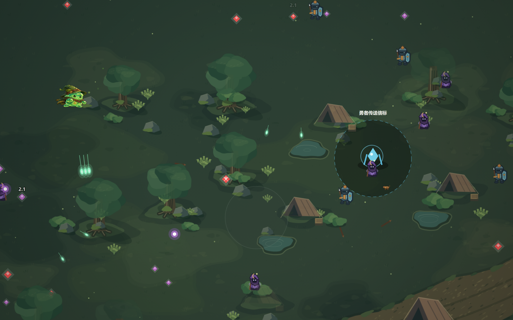
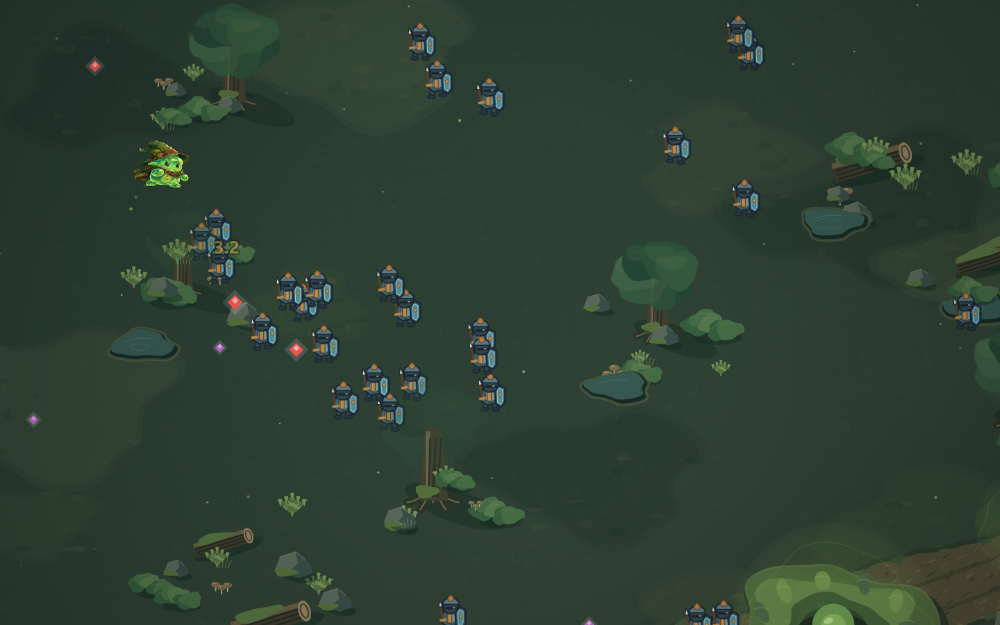

# Arena 真实战斗美术验收与原始史莱姆优化准备报告

验收日期：2026 年 10 月 30 日。

骑士、法师已在正常登录后的 Arena 中默认使用程序化缓存，没有被 Art V1 图片覆盖。两者的职业轮廓和色块语言基本统一，但当前整体美术尚不能判定为全面通过：原始史莱姆仍采用高细节图片；步态相位、接地阴影、特殊退场绘制与高 DPR 流畅度存在需要后续处理的问题。本阶段没有改动游戏运行代码、角色素材、战斗数据或动画时序。

## 验收环境与证据范围

- 工作分支：`codex/arena-art-acceptance-slime-review`，基于骑士/法师提交 `633d687` 新建。
- `main` 保持 `66b5123`。该基线本来就包含 Art V1；本阶段没有合入早期实验分支的整段历史，也没有删除或覆盖 Art V1 文件。
- 使用正常后端 `server/index.mjs`，将 `SLIME_DATA_DIR` 指向全新临时目录，只绑定本机端口 18023。通过真实注册、账号同步、开局凭证、菜单和战前简报进入战斗，没有模拟认证响应、伪造 Cookie、修改数据库内容或解除玩法解锁。
- 主要运行取证：本地 Vite 13023 的完整 Vue 应用与正式 Arena 管线，原生黏液、王庭逆袭、简单难度，自然推进第一、第二章。辅助脚本只发送移动、空格、升级及补给选择等正常输入，没有生成敌人、修改生命或攻击、快进游戏时间。
- 另在 18023 的生产构建入口正常注册并开局，核实加载的是 `/assets/index-DGwEIf4z.js`，不是开发源码。生产截图分别覆盖 DPR 2 与 DPR 1.25。
- Chromium `151.0.7922.34`，无头浏览器。开发态通过 Vue 已有实例只读取得引擎；计时包装保留原方法、参数与返回值。生产入口没有注入引擎诊断钩子。
- 所有本报告截图来自上述完整游戏。Canvas 关键帧保留真实世界画面，不含 Vue HUD；全页截图包含 HUD。没有使用独立预览页充当战斗证据。

## 真实战斗截图与录像

| 文件 | 内容及证据边界 |
|---|---|
| [real-normal.png](real-normal.png) | 第一章正常战斗，全页截图，DPR 1 |
| [real-density-28-first.png](real-density-28-first.png) | 第一轮自然较高密度，游戏时间 59.064 秒，28 个活跃且可见骑士；Canvas 原帧 |
| [real-knightAttack.png](real-knightAttack.png) | 第二轮 77.847 秒，骑士真实 `_swingT > 0`；19 个活跃、18 个可见敌人 |
| [real-mixed.png](real-mixed.png) | 第二轮 114.296 秒，第二章营道，骑士、法师、战獒与原始史莱姆处于同一真实场景 |
| [real-mageCast.png](real-mageCast.png) | 第二轮 128.045 秒，法师真实 `_shootFlash > 0`，DPR 2；18 个活跃敌人，其中法师 11、骑士 6、战獒 1，视口内 10 个 |
| [real-dpr2.png](real-dpr2.png) / [real-dpr3.png](real-dpr3.png) | 同一自然战斗切换 DPR 2 / 3 后的即时帧，后者引擎封顶 2；两图可见背景露黑，属于问题证据，不是画面通过证据 |
| [real-zoom125.png](real-zoom125.png) | 1152×720 CSS 视口、DPR 1.25，对应 1440×900 设备像素的 125% 缩放等效条件 |
| [production-dpr2.png](production-dpr2.png) / [production-zoom125.png](production-zoom125.png) | 生产构建、真实账号、正常开局；分别为 1440×900 CSS / 2880×1800 缓冲区，以及 1152×720 CSS / 1440×900 缓冲区 |
| [real-battle.webm](real-battle.webm) | 约 11.78 秒、1440×900、VP8，真实第二章混合战斗 Canvas 录像，展示移动、飞弹和场景融合；关键发射动作另见法师截图 |

普通战斗与较高密度战斗采用自然产生的不同时间段，不能视作固定种子的等条件性能 A/B。此次“较高密度”指实际观察到的 20–28 个可见敌人，不代表 100/250/500 敌人的压力验收。两种缩放入口使用设备指标仿真，未覆盖浏览器工具栏缩放、手机实机或人工长时间手感评审。

## 骑士与法师正式接入结果

`src/game/entities/Enemy.js:718` 先处理骑士、法师的缓存与实时回退，只有未处理的其他类型才进入旧 `drawArt` 路径。`ArenaKnightPrototype.js` 与 `ArenaMagePrototype.js` 无查询参数时都默认 `cache`。`?knightArt=a&mageArt=a` 仍可选择实时绘制；缓存表面不可用时也会调用实时绘制。

第二轮完整运行的实际绘制计数：

| 调用 | 次数 |
|---|---:|
| 骑士缓存 `draw` | 67,251 |
| 法师缓存 `draw` | 11,376 |
| `artV1EnemyKnight` | 0 |
| `artV1EnemyMage` | 0 |
| `artV1SlimeOrigin` | 8,143 |

Art V1 文件仍会被 AssetManager 加载；“网络请求加载了图片”不能证明该图片实际覆盖角色。上述计数是在绘制入口采集的。第一轮骑士缓存同样实际使用，生产构建截图也呈现新版骑士。

骑士沿用原 `_swingT` 与外部斩击弧，法师沿用 `_shootFlash`、现有冷却区间及脚下法阵；原弹道、攻击间隔和命中逻辑没有改动。接入核验通过，不等于所有动作已经达到最终美术质量。

## 视觉验收与问题优先级

下表中“代码”指可直接由当前实现确认，“运行”指真实截图或录像观察，“待验证”指尚不能归因或尚未覆盖。

| 优先级 | 发现与依据 | 影响及后续建议 |
|---|---|---|
| 高 | 原始史莱姆仍是厚涂图片；图片成功绘制后提前 `return`。【代码、运行】 | 主角拥有细碎衣帽、强高光和复杂材质，骑士/法师则是简洁色块；这是当前最主要风格断层。下一阶段只为 `origin` 恢复分层程序化表现，不批量切换其他形态。 |
| 高 | 实时绘制与缓存的步态相位单位不一致。【代码】 | Enemy 传入 `_walkT`；缓存将其作为弧度归一化，而两种实时绘制都使用 `sin(walkPhase * 2π)`。例如输入 π/2 时，实时步态为约 -0.430，缓存 move1 对应 +1。上次“动画完全一致”的结论应撤回；应统一渲染层相位单位并比较完整步态，保持 `_walkT` 更新速率不变。 |
| 高 | 高 DPR 的现场帧间隔明显增大。【运行，原因待验证】 | DPR 2 下平均渲染间隔约 76 ms，而 CPU `render()` 计时约 0.9 ms；不能直接归因于角色缓存。需在可见浏览器、实际 GPU 与稳定负载下定位合成/栅格化/环境调度，暂不通过高 DPR 流畅度验收。 |
| 高 | 动态切换 DPR 后的即时帧出现大块背景露黑。【运行，归因尚需复现】 | 稍后的 DPR 2 法师关键帧及独立生产入口截图正常。代码中 resize 重置 `_camInit`，相机初始化分支设置坐标后直接返回，跳过边界夹取；隔离夹具也能产生负相机坐标，与露黑相符。需分开验证切换首帧与稳定画面，不归咎于角色缓存，也不将有黑边的截图视为通过。 |
| 中 | 骑士/法师没有完整的普通接地阴影。【代码、运行】 | `Enemy.render()` 开头只设置阴影颜色，没有对应的普通地面填充；类模块也未补充地面影子。场景树石有投影，角色有悬贴感。以后在独立地面层补简洁椭圆影子，法师保留轻浮动，影子不随身体上下漂移。 |
| 中 | 缓存固定 64×64，不随 DPR 提升源分辨率；骑士帽尖存在极小裁切。【代码、像素检查】 | 扩展画布检查发现骑士待机最高到 y=-33，64 表面只能容纳 y≥-32，有 2 个非零透明度像素落在范围外；法师待机为 -30…17，无同类越界。正常尺寸不是严重缺角，但 DPR 2 边缘明显偏软。建议后续先加安全边距，再评估固定 1×/2×两档，避免按实例建缓存。 |
| 中 | 溃散与吞噬通道仍画旧 `char_${type}_0`，缓存 dead 帧未正式消费。【代码；吞噬未实战覆盖】 | `EnemyManager.js:1330` 之后绕开新 Enemy 绘制路径，外形可能在退场时跳变。后续只统一这些通道的视觉入口，保留原缩放、淡出、回收与伤害时序。 |
| 中 | 法师蓄力与发射共用一张 cast 帧，受击帧优先于攻击/施法帧。【代码、运行】 | 兜帽、袍体、法杖易于识别，发射可由紫色弹体判断，但身体动作阶段差异有限；受击时姿势可能临时复位。以后可增加少量施法姿态、将受击作为叠层，继续使用原有 0.5 秒区间和 0.12 秒闪光，不另设战斗时钟。 |
| 低 | 玩家先于 EnemyManager 绘制，普通敌人按列表顺序绘制，没有按脚点统一排序。【代码】 | 聚集时遮挡关系可能不符合斜俯视空间。此次未观察到妨碍操作的严重遮挡，不建议为此立即重构整个场景排序。先用固定重叠截图确定是否需要局部调整。 |

画面观察：骑士的蓝灰金属、金棕小配色与法师的低饱和紫袍都能从森林中分离；两者同属深轮廓、少量明暗、夸张职业器物的语言，已具备统一基础。法师袍体与骑士甲胄轮廓不同，职业没有混淆。当前视角仍偏直立正面、以左右翻转表示朝向，2.5D 体积感较弱；适合作为轻量基础，不应描述成已达到样板图的完整斜俯视效果。

28 个可见骑士聚集时，盾牌轮廓仍可辨认，但个体重叠后主要依赖同一蓝灰色团块。混合战斗里法师的紫色块更容易区分。没有在本次片段中发现持续闪烁或大幅锚点跳动，但上述相位问题使“缓存无动画损失”仍不成立。

## 实际性能与此前两次基准的差异

本次没有重复大规模角色基准。只在完整战斗中用 `performance.now()` 分别计量现有 `update()`、`render()` 的 CPU 调用耗时，并记录相邻渲染的墙钟间隔。表内时间均为毫秒；间隔不小于 200 ms 的暂停/异常长间隔不参与分位统计，原始样本仍保留。诊断包装、采图和录像会有附加开销，CPU 绘制计时也不包含全部 GPU 完成时间。

| 运行片段 | 样本帧 | 活跃敌人数 | update 均值 | render 均值 / P95 | 渲染间隔均值 / P95 |
|---|---:|---:|---:|---:|---:|
| 第二轮 DPR 1 全段 | 7,070 | 0–25 | 0.204 | 0.882 / 1.200 | 17.862 / 22.900 |
| 第一轮 DPR 1，20–28 个可见敌人 | 2,355 | 23–28 | 0.187 | 0.934 / 1.200 | 17.449 / 20.700 |
| 第二章 DPR 1，骑士法师混合 | 754 | 3–17 | 0.231 | 0.732 / 1.000 | 18.449 / 22.500 |
| 第二轮 DPR 2 | 239 | 16–19 | 0.267 | 0.903 / 1.100 | 76.254 / 94.700 |
| 浏览器 DPR 3，引擎封顶 2 | 241 | 13–18 | 0.302 | 0.936 / 1.100 | 71.067 / 86.500 |
| 125% 等效条件，DPR 1.25 | 581 | 15–19 | 0.249 | 0.737 / 1.000 | 21.613 / 27.700 |

以上是依次采集的不同战斗片段，敌人组成、可见数、技能、录屏及视口不完全相同，不能用来计算缓存相对实时绘制的加速倍数。高 DPR 的长间隔是真实观察，原因尚未定位；将约 0.9 ms 的 CPU `render()` 当成整帧预算、或将长间隔直接归咎于缓存，都会误判。DPR 1 在本次自然密度下表现可用；百级敌人、技能饱和及高 DPR 长局仍未验收。DPR 切换即时截图还有背景露黑，因此尺寸计算正确不代表切换过程画面正确。

此前两次数字差异有具体的测试口径原因：

| 项目 | 骑士早期缓存实验 `896dc88` | 骑士法师实验 `633d687` |
|---|---|---|
| 画布 | 1100×300 | 256×256 |
| 放置方式 | 两路均 save/translate/restore，在一排区域反复绘制 | 实时路没有平移，角色一直画在原点；缓存路有 x/y，部分对象落在画布外 |
| 实际尺寸 | 实时传 radius=21；缓存内部额外乘 1.52，因此缓存角色大约高 1.52 倍 | 实时 radius=15.2 与缓存逻辑 radius=10 经乘 1.52 后尺寸匹配，但位置/裁剪不匹配 |
| 采样 | 20 次预热、60 帧采样，均值和 P95；无逐帧清屏 | 60 帧循环，逐帧清屏，无显式预热、无 P95 |
| 所谓模拟列 | 只有位置及相位加法，不是正式战斗 | 没有独立模拟列 |
| 历史骑士结果 | 100/250/500：24.485→4.197、51.953→12.980、116.798→35.947 ms | 100/250/500：3.800→0.203、8.378→0.500、20.327→0.832 ms |

浏览器的 Canvas 提交、延迟栅格化、裁剪、内存回收及机器负载也会影响这些连续循环。两次“3–6 倍”与“16–24 倍”既不能横向比较，也不应作为正式战斗性能承诺。旧实验图片的上下角色大小本身就不一致，不能证明无质量损失。本次不删除历史数据，在旧记录前增加勘误，避免继续引用失真的倍数。

可保留的结论是：固定帧确实减少了运行时的路径构造与填色调用，当前正常战斗也确实走缓存；精确收益仍需以后用同场景、同位置、同尺寸、相同可见性和绘制完成口径的小规模配对测试确定。源码估算的基础像素存储仍为骑士 128 KiB、法师 112 KiB，合计 240 KiB；这不是进程内存或 GPU 占用实测。

## 原始史莱姆的现状

本节只评估 `origin`。暴食、元素、暗影等仅用于说明共用接口边界，没有实施其外观改造。

| 层次 | 当前实现与保留能力 |
|---|---|
| 基础外观 | `SlimeAppearance.js` 提供共享 400×320 坐标的身体路径、绿灰调色板、腹部、少量泡泡、高光及五官。原始程序化身体是圆润软体，不是图片中的穿衣戴帽人物结构。 |
| 身体缓存 | `SlimeRenderer.js:92` 按血统将静态身体画入 400×320 离屏 Canvas；`renderSlimeBody()` 运行时只 drawImage。现有方案已经是“静态身体缓存＋实时表情”的混合绘制。 |
| 表情 | `renderSlimeFace()` 实时绘制；眨眼和受击会压缩眼睛。Player 虽计算 angry/lowhp 等状态，但没有将这些状态传为独立脸型；原始嘴型基本固定。不能声称关闭图片即可自动恢复全部旧表情。 |
| 连续动画 | Player 保有待机呼吸、`moveBlend` 起停缓动、移动拉伸、小角度倾斜、吞噬脉冲、急停 wobble 的代码、无敌闪烁、受击波纹及现有攻击 pose 接口。图片路径仍继承提前执行的整体形变、透明度、阴影与外围粒子，并非完全静止。 |
| Art V1 优先级 | 图片成功时，身体图片以居中、保持纵横比方式占 `r*3.2` 的包围盒，然后提前返回。后面的程序化身体、面部、进化配件/染色、身体红闪和内部波纹都被跳过。运行计数确认原始史莱姆目前持续使用该路径。 |
| 尺度和锚点 | 玩家碰撞半径固定 26；程序化 origin 身体包围盒约 62×42 CSS px，Art V1 外框约 83×78 CSS px，数值均为未经动态形变的近似。不能把图片包围盒直接当成可见身体或碰撞范围。图片以中心锚定，原程序化影子则按原脚点定位，需要下一阶段专门校准。 |
| 阴影 | Player 在世界坐标中于 y+0.85r 画软椭圆影子，压扁比例 0.32；与身体形变分离的思路可保留。它原本匹配程序化脚点，不能假定也匹配衣帽图片的透明边界。 |
| 进化 | `_mutation()`、元素配件、染色与粒子接口已存在；部分外围效果在图片提前返回前执行，身体内部效果在返回后，因此当前进化外观可见能力不完整。 |

急停 wobble 的触发也应复查：`prevBlend - moveBlend > 0.35` 在常见 60fps 的缓动步长中通常不会达到，不能只凭存在这段代码就认为实际急停效果已经充分发挥。本次没有改触发条件或动画参数。

## 建议采用的基础美术规范

继续使用现有 Canvas 架构。主角只有一个，没必要照搬敌人的少量固定姿态帧，牺牲连续果冻形变。建议保留高分辨率静态身体缓存、实时矢量五官、现有连续变换和状态叠层。

- 视角与轮廓：圆润、低重心，顶部可见、下沿有 3–4 个明确接触瓣；主体保持简单。先按可见身体而非含帽外框对齐骑士高度，约 0.7–0.9 倍作为试验起点，同时保证轮廓覆盖既有碰撞区域，不能为追求“小可爱”制造不可见受击边界。
- 色彩与材质：复用 origin 现有灰绿 `#a7cb86`、暗绿 `#426345`、浅绿 `#edffe4`，保留比背景更亮的主体面；主要用亮面、基色、底部暗面三个层次，加一块上左高光和少量半透明内泡。减少满身强白斑、微小纹理和装饰亮点。
- 轮廓与光照：以普通显示尺寸约 1.5–2 CSS px 深色轮廓作为试验值，内线更细；光向固定上左，与骑士头盔和场景树石读法一致。避免通过整身发光来分离主角。
- 接地：明确“世界脚点、身体局部原点、阴影中心”三者；影子固定在世界地面，身体可向上回弹。上半部高光和底部暗面表现果冻体积，影子只承担接地。
- 表情与动画：保留现有时间源、呼吸与 moveBlend 系数；下一阶段先让 blink/hurt、低血量和移动表情正确映射，再考虑小幅面部延迟。身体、五官和阴影采用清楚的层次，不使用新的伤害/攻击时钟。
- 身份特征：原始史莱姆保持中性圆润基础；当前图片里的帽子若继续保留，应作为 origin 专属、可独立简化的配件层，不能把厚涂衣帽结构变成所有形态的共享身体。
- 复用边界：共享坐标、脚点、光向、描边规则和状态输入；各形态仍保留自己的身体路径、色板、脸型、配件及攻击 pose。暴食的宽体与嘴、元素核心、暗影轮廓不应被统一成同一张身体。

现有 400×320 身体缓存对原始半径 26、常见 DPR≤2 已有充足源分辨率，应先复用。只有实际放大测试证明不足时才增加有限清晰度档位；不要按每帧时间、角色实例或任意半径不断创建缓存。共享 `SlimeAppearance` 还被菜单 SVG 头像使用，修改必须限定 origin 并检查头像，不连带变更其他五种形态。

## 下一阶段可执行方案

以下均待用户审核后实施，本次没有执行。

| 阶段 | 范围与交付 | 风险与验证方式 |
|---|---|---|
| 先完成本次发现的窄范围校准 | 骑士/法师只修正渲染相位约定、缓存安全边界和接地影子；退场视觉另列小补丁。高 DPR 先做可见浏览器短测，并复现 resize 首帧相机边界。 | 不改 `_walkT` 更新和攻击计时；同一相位逐帧截图比对、左右翻转和受击叠加检查；未获审核不扩展第三种敌人。 |
| 原始史莱姆可回退原型 | 增加仅影响 origin 的渲染选择，保留 Art V1；只调整 origin 外观数据与分层组合，交付正常森林战斗的旧/新对比。 | 图片成功后的提前返回必须按 origin 局部控制，不影响其他血统。固定 r=26、技能范围、伤害和已有动画参数。核对菜单头像、脚点和碰撞覆盖。 |
| 原始史莱姆表情与连续动态 | 使用现有 body/face/pose 接口，补全明确的脸型映射；展示待机、起步、持续移动、急停、受击、低血量和一次合法进化。 | 不为动画引入新战斗状态；用相同输入、时间戳和攻击事件验证伤害帧不变。先核查急停触发，再决定是否有必要调整纯视觉事件。 |
| 真实混合战斗验收 | 同一森林内对照骑士、法师与原始史莱姆；录制正常及更高自然密度；DPR 1/1.25/2，固定缩放与配对视口。 | 分开计量模拟、绘制和呈现间隔。检查透明叠层、阴影、前景遮挡、面部清晰度、掉帧与缓存数量稳定性。完成后停止，不自动推广其他形态。 |

## 测试结果与未完成事项

本阶段通过：

- `node --check test-support/arena-art-acceptance.mjs`。
- 两轮登录态正式 Arena 自然战斗，合计保存 16,581 个渲染样本，浏览器未捕获到未处理脚本错误。
- 生产构建入口两种设备条件下正常注册、开局、加载构建资源与画布尺寸验证，无页面脚本错误。
- `npm run test:arena-knight-mage`（该 Node 测试只是基本契约，不等同于像素/动画等价测试）。
- `node verify-glutton.mjs`：28 组；`node verify-boss-animation.mjs`：104 场景、13 次重置、20 项时钟检查。
- `node verify-art-v1.mjs`：16 个 RGBA 素材及基线钩子；`npm run build` 通过。仍有既有大于 500 kB 构建分块提示。
- `ffprobe` 验证录像为 VP8、1440×900、约 11.78 秒。未把可变帧率录像标成稳定 24/30 FPS。

未完成：真实登录态下 100 个以上混合敌人和技能饱和压力；高 DPR 在可见浏览器/GPU 实机上的瓶颈定位；原始史莱姆逐表情及进化专项运行矩阵；新版敌人吞噬/溃散外观的一致性修复；手工浏览器工具栏缩放。没有重跑完整 `npm test`，也没有把此前中断的全套测试记为通过。

本阶段新增/修改文件仅为本报告、截图/录像/数据、真实战斗辅助脚本及历史基准说明勘误。`src/`、`public/`、包清单和依赖锁文件相对 `633d687` 无变化。缓存与实时两路、Art V1、暴食近战和 Boss 动画成果均保留。

## 复查与数据

- [performance-summary.json](performance-summary.json)：按真实 DPR 分组的统计、绘制计数、截图时刻和升级选择。
- [runtime.json.gz](runtime.json.gz) 与 [runtime-first.json.gz](runtime-first.json.gz)：两轮逐帧原始样本，gzip 压缩保存；超过阈值的原始间隔没有删除。
- [production-smoke.json](production-smoke.json)：生产构建入口、设备像素与 CSS 尺寸、缓存边界技术检查。
- [camera-resize-check.json](camera-resize-check.json)：原相机方法的隔离夹具，首帧坐标 -620/-350，下一帧回到 0/0；该检查没有修改真实战斗相机。
- 辅助脚本：`test-support/arena-art-acceptance.mjs`。需安装环境已有 Playwright Core；通过 `PLAYWRIGHT_MODULE` 指向其路径，不添加项目依赖。先启动隔离数据目录的正常后端和对应代理端口，再运行脚本；切勿把脚本指向现有玩家服务。

结论：保留普通敌人的小型帧缓存路线，但先解决本次质量校准项；原始史莱姆适合复用当前程序化分层与连续动画能力进行局部升级。暂不需要新引擎、统一复杂动画框架或全项目重构。本阶段到此停止，等待视觉审核。
